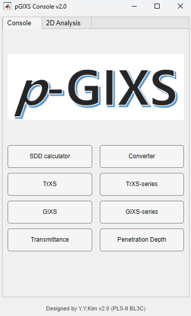
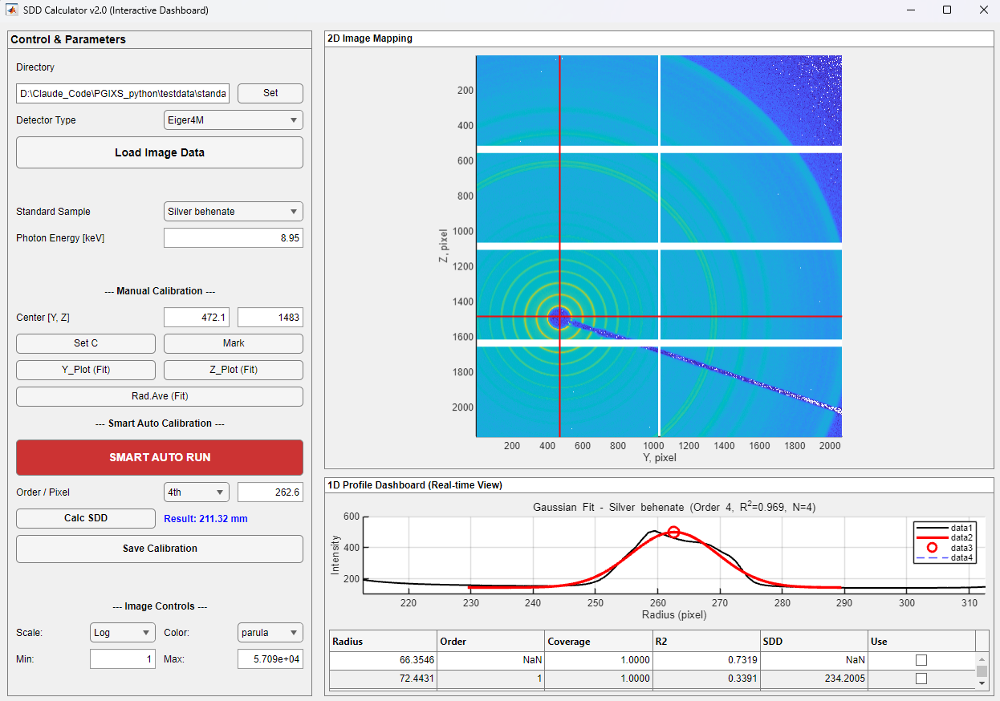
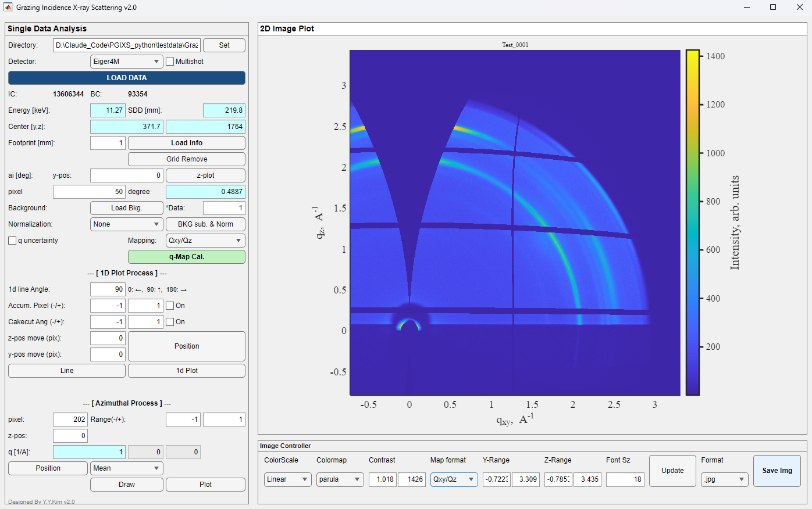
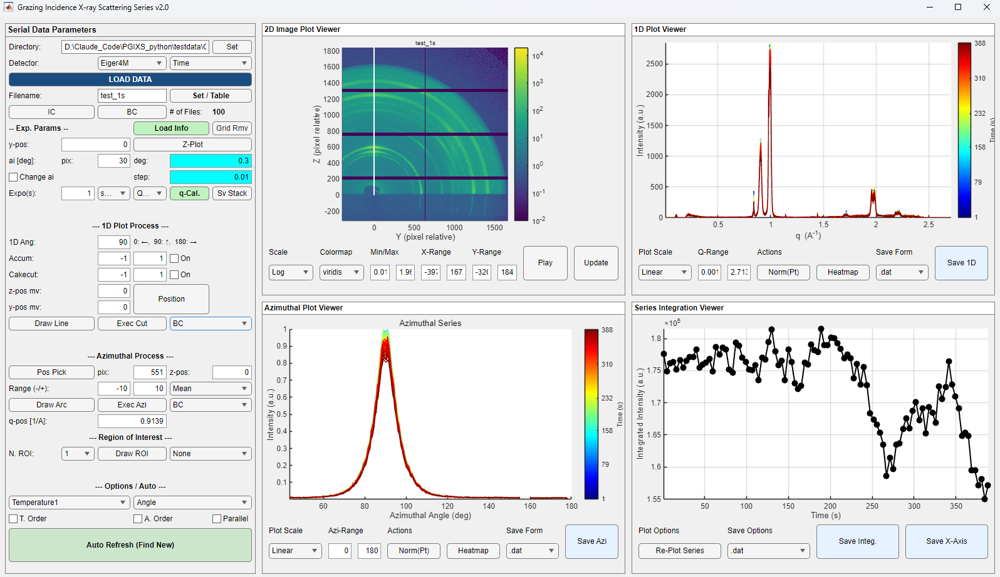
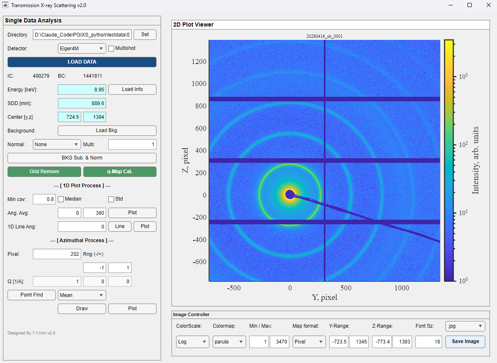
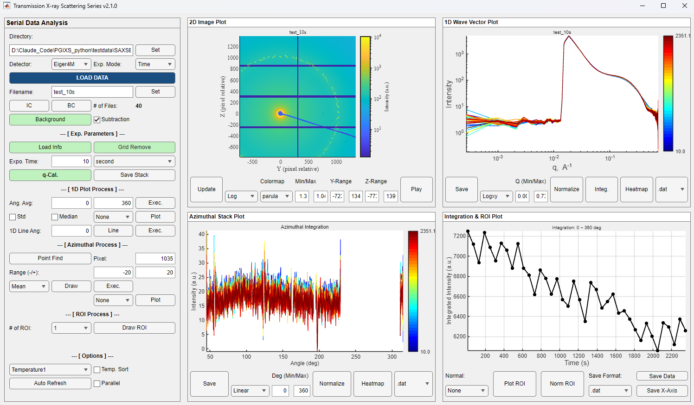
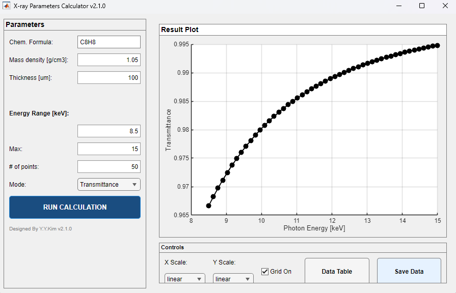
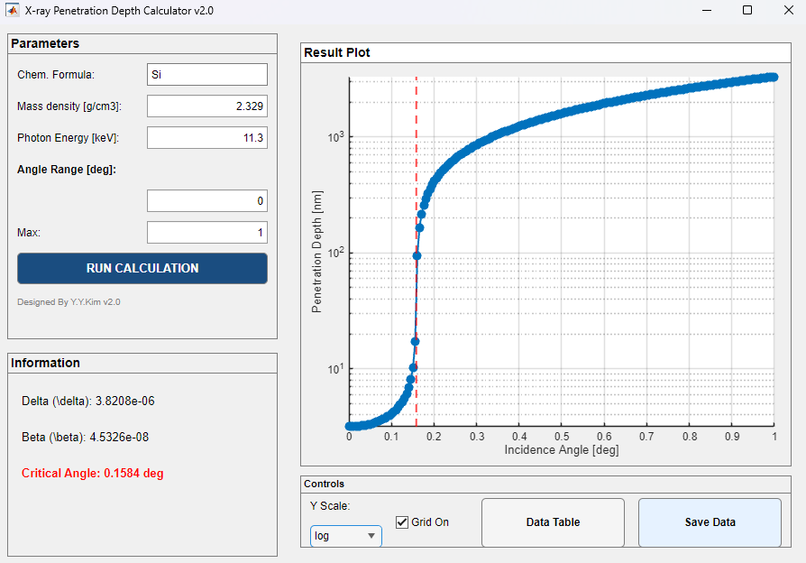
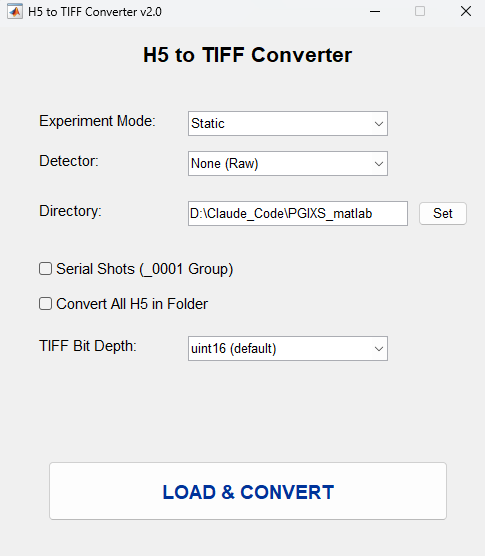

# PGIXS MATLAB 사용자 매뉴얼

PGIXS는 **MATLAB 버전**과 **Python 버전** 두 가지로 제공된다. 이 문서는 그중
**MATLAB 버전(원본 구현)**의 사용자 매뉴얼이다. MATLAB 라이선스가 필요한 대신,
Python 버전에는 없는 **H5→TIFF 변환기**를 포함한다.

프로그램은 `PGIXS.m`이 여는 **pGIXS Console** 창에서 시작하며, 콘솔은 계산을 하지
않고 개별 도구 창을 띄우는 런처 역할만 한다.

> Python 버전 매뉴얼은 해당 저장소의 `docs/desktop_manual_ko.md`에 있다. 두 버전의
> 계산 결과가 어디까지 일치하고 어디서 갈리는지는 [12. 부록](#12-부록-python-버전과의-관계)에
> 정리했다.

---

## 목차

1. [전체 구조와 사용 순서](#1-전체-구조와-사용-순서)
2. [SDD Calculator](#2-sdd-calculator)
3. [GIXS (단일 프레임)](#3-gixs-단일-프레임)
4. [GIXS-series](#4-gixs-series)
5. [TrXS (단일 프레임)](#5-trxs-단일-프레임)
6. [TrXS-series](#6-trxs-series)
7. [Transmittance (XTrans)](#7-transmittance-xtrans)
8. [Penetration Depth](#8-penetration-depth)
9. [Converter (H5 → TIFF)](#9-converter-h5--tiff)
10. [공통 개념 정리](#10-공통-개념-정리)
11. [문제 해결](#11-문제-해결)
12. [부록: Python 버전과의 관계](#12-부록-python-버전과의-관계)

---

## 1. 전체 구조와 사용 순서

### 1.1 실행

```matlab
cd /path/to/PGIXS_matlab
PGIXS
```

`PGIXS.m`이 `functions/`와 `gui/tab1/`을 MATLAB 경로에 추가하고 **pGIXS Console**
창을 연다.

| 버튼 |
| --- |
| SDD calculator · Converter · TrXS · TrXS-series · GIXS · GIXS-series · Transmittance · Penetration Depth |



### 1.2 실행 환경

- **MATLAB R2024a 이상 권장** (R2020a 이상이면 동작한다. `uifigure` 계열 UI 컴포넌트와
  `writematrix`를 쓴다.)
- **필수 툴박스**
  | 툴박스 | 쓰이는 곳 |
  | --- | --- |
  | Curve Fitting | 1D 창의 Gaussian 피크 피팅, `fitPGIXSGaussianPeak.m` |
  | Image Processing | ROI 도구(`drawline`/`drawrectangle`/`drawpolygon`), TrXS의 `roipoly` |
  | Signal Processing | `findpeaks` 기반 링 검출 (SDD 캘리브레이션) |
  | Parallel Computing | GIXS-series/TrXS-series의 `Parallel` 체크박스 — **선택 사항** |

  Parallel Computing만 없어도 동작한다(직렬로 대체). 나머지는 정상 사용에 필요하다.

### 1.3 표준 워크플로

```
  캘리브런트 측정                        시료 측정
        │                                  │
        ▼                                  │
  [SDD calculator]                         │
   빔 중심 + SDD 결정                       │
   → *_standard.mat / .std / .json         │
        │                                  │
        └──────────────┬───────────────────┘
                       ▼
        [GIXS] 또는 [TrXS]  (단일 프레임)
         Load Info → q-Map Cal. → 1D/Azimuthal 컷
                       │
                       └─→ 시리즈면 [GIXS-series] / [TrXS-series]
                             시간·온도·입사각 축으로 프레임 묶음 처리
```

보조 계산기인 **Transmittance**와 **Penetration Depth**는 이 흐름과 독립적이며,
측정 전에 시료 두께나 입사각을 정할 때 쓴다.

**어느 도구든 `q-Map Cal.`(GIXS/TrXS) 또는 `q-Cal.`(series)을 먼저 실행해야 1D 처리가
열린다.** 그 전에는 대부분의 계산 버튼이 경고를 띄우고 아무것도 하지 않는다.

---

## 2. SDD Calculator

**SDD Calculator v2.0 (Interactive Dashboard)** — 표준 시료(캘리브런트) 이미지에서
빔 중심과 시료–검출기 거리(SDD)를 결정한다. 여기서 저장한 파일을 GIXS/TrXS의
**Load Info**가 읽으므로, 실험 세션의 첫 단계다.



### 2.1 왼쪽 패널

**데이터 로드**

- **Directory** / **Set** — 작업 폴더 선택.
- **Detector Type** — 검출기 선택. 검출기별 마스크와 픽셀 크기가 여기서 결정된다.
- **Standard Sample** — `SEBS` / `Silver behenate` / `Mesoporous Silica` / `Sucrose`.
  각 표준의 1차 링 q값이 내장돼 있다(2.4절 참고).
- **Photon Energy [keV]** — 측정 에너지. 파장 λ = 12.3984 / E [Å].
- **Load Image Data** — 캘리브런트 이미지를 연다.

**Manual Calibration** (수동 경로)

- **Center [Y, Z]** — 현재 빔 중심. **1-based 픽셀 좌표**(첫 픽셀이 1)다.
- **Set C** — 켠 뒤 이미지를 클릭하면 그 위치가 중심이 된다. 대략만 맞추면 된다.
- **Mark** — 현재 중심에 십자선을 그린다.
- **Y_Plot (Fit)** / **Z_Plot (Fit)** — 중심을 지나는 수평·수직 라인 프로파일을 띄운다.
  그 창에서 범위를 선택하고 Gaussian 피팅을 하면 링 위치를 정밀하게 얻고,
  중심으로 되돌릴 수 있다.
- **Rad.Ave (Fit)** — 방사 평균 프로파일. 링 반경을 읽는 가장 일반적인 경로다.
- **Order / Pixel** — 피팅으로 얻은 링의 차수와 반경(픽셀).
- **Calc SDD** — 위 값으로 SDD를 계산한다. 결과가 **Result: - mm** 라벨에 표시된다.

**Smart Auto Calibration** (자동 경로)

- **SMART AUTO RUN** — 현재 중심에서 시작해 빔 중심을 정밀화하고, 보이는 링들을
  자동으로 찾아 차수를 판정한 뒤 SDD를 낸다.

  **중심을 대략이라도 먼저 지정해야 한다.** 전역 탐색이 아니라 국소 정밀화이기
  때문에, 이미지 정중앙 같은 엉뚱한 위치에서 시작하면 실패한다.

  차수 판정은 "가장 안쪽 링 = 1차"로 가정하지 않고, **링들이 서로 같은 SDD를 주는지
  (일관성)** 를 기준으로 한다. SDD가 짧아 1차 링이 빔스탑에 가려진 패턴에서
  보이는 링을 2·3차로 올바르게 읽기 위한 것이다.

**Save Calibration** — 캘리브레이션을 저장한다. 파일 형식은 2.3절 참고.

### 2.2 오른쪽 패널

- **2D Image Plot** — 캘리브런트 이미지. **Set C**가 켜져 있으면 클릭으로 중심 지정.
- **Image Controls** — **Scale**(Linear/Log), **Color**(컬러맵), **Min** / **Max**(대비).
  링이 잘 안 보이면 Scale을 Log로 바꾸는 것이 가장 효과적이다.

### 2.3 저장 파일 형식

**Save Calibration**은 같은 이름으로 세 가지를 쓴다.

| 파일 | 내용 |
| --- | --- |
| `{파일명}_standard.mat` | MATLAB 구조체. `pc`(빔 중심 [y,z]), `wavelength`, `pixelsize`, `sdd`, `dttypename`, `STpeak`/`STqvalue`(링 반경/q값), `imgdim`, `SDDDiagnostics`(Smart Auto Run 후보 테이블) |
| `{파일명}_standard.std` | `stdsave.m` 형식의 5구획 텍스트. 다른 프로그램에 넘기기 쉬운 최소 형식 |
| `{파일명}_standard.json` | Python 버전과 공유하는 형식. `.mat`과 같은 필드 구성 |

**빔 중심은 세 파일 모두 1-based 픽셀 좌표를 그대로 담는다.** Python 버전도 같은
관례이므로 어느 쪽에서 저장한 파일이든 그대로 주고받을 수 있다.

> 커밋 `89c4c85` 이전 버전은 `.json`에만 빔 중심을 1픽셀 낮게 저장했다. 그 시절
> 파일을 Python 버전에서 읽으면 두 축 모두 한 픽셀 어긋난다 — 해당 파일은 이
> 버전에서 다시 저장하거나, `.mat`을 대신 쓰면 된다.

### 2.4 계산 원리

표준 시료의 q값을 차수로 곱해 기준 q를 얻는다.

| 표준 | 1차 q [Å⁻¹] |
| --- | --- |
| Silver behenate | 0.1052 |
| SEBS | 0.01916 |
| Mesoporous Silica | 0.059264 |
| Sucrose | 0.5933 |

`q = base_q(Standard) × Order` 로 두고, 파장 `λ = 12.3984 / E[keV]`에서

```
θ  = arcsin(q·λ / 4π)
2θ = 2θ (deg 변환)
SDD[mm] = Pixel Radius × pixel_size[mm] / tan(2θ)
```

`arcsin`의 정의역을 벗어나거나(q가 너무 큼) `2θ`가 0 이하이면 계산이 실패하고
에러가 표시된다.

---

## 3. GIXS (단일 프레임)

**Grazing Incidence X-ray Scattering v2.0** (`GIXS_gui.m`) — 스침각 입사 기하의
단일 프레임을 Q-space로 변환하고 1D/방위각 프로파일을 뽑는다.



### 3.1 왼쪽 패널 — 로드와 보정

- **Directory** / **Set**, **Detector**, **LOAD DATA** — 데이터 로드. 지원 형식은
  `.h5`, `.tif/.tiff`, `.mat`, `.spe`, `.csv`, `.dat`, `.txt`.
- **Multishot** — 같은 시리즈의 여러 샷을 평균해서 한 장으로 읽는다.
- **IC:** / **BC:** — 이온챔버·빔카운터 값. 정규화에 쓴다.
- **Load Info** — SDD Calculator가 저장한 캘리브레이션을 불러온다. **Energy [keV]**,
  **SDD [mm]**, **Center [y,z]**가 채워진다. **이걸 하지 않으면 q-Map Cal.이 막혀 있다.**
- **ai [deg]:** — 입사각. 직접 입력하거나, `pixel` / `degree` 필드로 환산한다
  (직접빔과 반사빔 사이 픽셀 거리로부터 `ai = atan(pix·p/SDD)/2`).
  **한쪽에 숫자를 넣고 Enter를 누르면 다른 쪽이 자동으로 계산된다.**
  픽셀 피치는 **Detector** 선택에서 오므로, 데이터를 불러오기 전에도 된다 —
  SDD만 들어있으면 된다. 측정 전에 입사각을 정할 때 쓰는 기능이다.
- **z-plot** — 수직 라인 프로파일 창. 입사각용 픽셀 위치를 읽을 때 쓴다.
- **Footprint [mm]:** + **q uncertainty** — 시료 위 조사 면적을 SDD의 ±FP/2
  불확실성으로 취급해 q 좌표 자체의 근사 오차를 계산한다. 1D 플롯의 X축 error bar와
  저장 파일의 표준편차 컬럼에 반영된다.
- **Background:** / **Load Bkg.** / **BKG sub. & Norm** — 배경 프레임을 빼고
  IC/BC로 정규화한다.
- **Grid Remove** — 검출기 모듈 간격(그리드)을 보정한다.
- **q-Map Cal.** — 아래 3.4절의 Q 맵과 검출기 보정을 계산한다. **모든 1D 처리의 전제.**

### 3.2 1D Plot Process

- **1d line Angle:** — 컷 각도. 라벨의 `0: →, 90: ↑, 180: ←`가 방향 규약이다.
- **Position** — 이미지를 클릭해 컷 위치를 지정.
- **Line** — 컷 선을 이미지에 그린다.
- **1d Plot** — 컷을 실행하고 1D 창을 띄운다.
- **z-pos move (pix):** / **y-pos move (pix):** — 컷을 빔 중심에서 수직/수평으로
  옮긴다. 0이 아니면 컷은 고정된 Qz(수평 컷) 또는 Qxy(수직 컷) 위를 지나가므로,
  **X축이 |Q| 대신 컷을 따라 변하는 성분으로 바뀐다.**
- **Cakecut Ang (-/+):** + **On** — 기준 각도 주변의 각도 쐐기 평균. 켜면 단일 광선
  대신 쐐기 안의 픽셀을 q-bin으로 평균한다. y/z-pos move의 영향을 받지 않는다.
- **Accum. Pixel (-/+):** — 컷 라인에 수직인 픽셀 밴드를 평균한다. 축은 |Q|로 유지된다.
  Cakecut과 동시에 켤 수 없다.
- **Mean / Median** — bin 대표값.

### 3.3 Azimuthal Process

고정된 반경의 링 위에서 각도별 강도를 뽑는다. 배향(orientation) 분석의 기본 도구다.

- **pixel:** — 링 반경(픽셀). **q [1/A]:** 로도 표시된다.
- **Range(-/+):** — 반경 폭.
- **z-pos:** — 링 중심을 수직으로 옮긴다.
- **Position** — 이미지에서 목표 지점을 클릭하면 그 반경이 자동 입력된다.
- **Draw** — 적분에 쓰이는 링을 이미지 위에 표시한다.
- **Plot** — 방위각 프로파일 창을 띄운다.

각도는 0~180°를 0.2° 간격으로 스윕한다. GI 기하는 수평선 위쪽만 의미가 있기 때문이다.

### 3.4 q-Map Cal.이 하는 일

**Q 맵** — 선택한 **Map format**(`Qxy/Qz` 또는 `Qy/Qz`)에 따라 픽셀마다 좌표를 계산한다.
입사각 αi가 들어가므로 빔 중심을 기준으로 위아래가 대칭이 아니다.

**검출기 보정** — 강도를 다음 인자로 나눈다.

```
solid angle × polarization × 캡톤(Kapton) 창 투과율 × [Eiger4M이면] 실리콘 센서 흡수
```

**리그리딩** — 균일 Q 격자로 다시 뿌린 `Itrans` 이미지와, `2θf`/`αf` 좌표의 `AlphaMap`을
함께 만든다. **Map format** 드롭다운으로 화면에 어느 것을 볼지 고른다.

`Mapping`을 `Qxy/Qz`나 `Qy/Qz`로 두면 1D·방위각 컷도 **리그리딩된 이미지를 자른다.**
픽셀 공간에서는 보이지 않는 Q 공간의 커버리지 공백(missing wedge)이 그대로 반영된다.

### 3.5 오른쪽 패널

- **2D Plot Viewer** — 현재 이미지. Map format에 따라 축이 픽셀/Q/각도로 바뀐다.
- **Image Controller** — **ColorScale**, **Colormap**, **Contrast**(Min/Max),
  **Y-Range** / **Z-Range**(표시 범위), **Font Sz**, **Update**(반영), **Save Img**.
- **Format** — 이미지 저장 형식.

### 3.6 작업 순서 정리

1. **Detector** 선택 → **LOAD DATA**
2. **Load Info**로 캘리브레이션 로드
3. **ai [deg]** 입력 (또는 z-plot으로 픽셀 읽어 변환)
4. 필요하면 **Load Bkg.** → **BKG sub. & Norm**, **Grid Remove**
5. **q-Map Cal.**
6. **Map format** 선택 → 1D 또는 Azimuthal 처리
7. 결과 창에서 저장

---

## 4. GIXS-series

**Grazing Incidence X-ray Scattering Series v2.0** (`GIXS2_gui.m`) — 프레임 묶음을
한 번에 축약하고, 시간·온도·입사각 축에 대해 커브를 쌓아 본다. *in-situ* 측정의
주 도구다.



### 4.1 Serial Data Parameters / Load

- **Directory** / **Set**, **Detector** (`Eiger4M` / `MarCCD` / `MX170HS` / `PI-CCD`)
- **Exp. Mode** — `Time` / `Temperature` / `Angle` / `LowTemp.`. 어떤 메타데이터를
  X축으로 쓸지 결정한다.
- **LOAD DATA** — 시리즈 중 한 프레임을 골라 파일명 접두어를 잡는다.
- **Set / Table** — 접두어가 맞는 파일 목록 창(**File List (Series)**)이 열린다.
  체크한 파일만 불러온다. **# of Files:** 에 개수가 표시된다.
- **Parallel** — 병렬 로딩/처리. Parallel Computing Toolbox가 있을 때만 의미가 있다.
- **IC** / **BC** — 이온챔버·빔카운터 값을 파일에서 읽어 채운다.
- **Load Info** — 캘리브레이션 로드.
- **Grid Rmv** — 그리드 보정.
- **Sv Stack** — 불러온 스택을 통째로 저장.

### 4.2 Incidence Angle Calibration

- **ai [deg]:**, **pix:**, **deg:**, **step:** — 입사각과 그 변환값.
  **pix / deg 중 한쪽에 숫자를 넣고 Enter를 누르면 다른 쪽이 자동으로 계산된다**
  (Load Info로 SDD가 들어와 있어야 한다).
- **Z-Plot** — 수직 프로파일 창에서 직접빔/반사빔 픽셀을 읽는다.
- **Change ai** — **입사각 스캔** 모드. 프레임마다 입사각이 다를 때 켠다. 켜면
  q-Cal.이 프레임별로 Q 맵을 다시 계산한다(느리지만 정확하다).
- **q-Cal.** — 시리즈 전체에 Q 맵과 검출기 보정을 적용한다.
- **Expo(s):** — 노출 시간. 시간축을 만들 때 프레임 간격 보정에 쓴다.

### 4.3 1D Plot Process

- **1D Ang:** — 컷 각도 (`0: →, 90: ↑, 180: ←`).
- **Position** / **Draw Line** — 컷 위치 지정과 표시.
- **Accum:** / **Cakecut:** — 단일 프레임 GIXS와 같은 의미(3.2절).
- **z-pos mv:** / **y-pos mv:** — 오프셋 컷.
- **Exec Cut** — 모든 프레임에 컷을 실행한다. 진행 표시가 뜬다.

### 4.4 Azimuthal Process

- **q-pos [1/A]:** / **Range (-/+):** / **z-pos:** — 링 위치와 폭.
- **Pos Pick** — 이미지 클릭으로 반경 지정.
- **Draw Arc** — 적분 링 표시.
- **Exec Azi** — 프레임별 방위각 프로파일 계산.

### 4.5 Region of Interest

- **N. ROI:** — ROI 개수.
- **Draw ROI** — 이미지 위에 사각형을 그린다.
- ROI 영역의 **합계**를 프레임별로 추적한다. 상전이나 세기 변화를 한눈에 보는 용도다.

> ROI 합계에는 갭 경계 버퍼가 적용되지 않는다. 평균이 아니라 합계이므로 픽셀을
> 빼면 값 자체가 달라지기 때문이다(11절 참고).

### 4.6 Options / Auto

- **T. Order** / **A. Order** — 온도·각도 기준 정렬. 온도가 단조롭지 않은 시리즈에서
  X축을 정렬하면 **데이터도 같이 재배열된다.**
- 시간 단위 (`second` / `min` / `hour`), X축 소스
  (`Temperature1` / `Temperature2` / `Temperature3` / `Time`, 또는 `Angle` / `Time`).
- **Auto Refresh (Find New)** — 폴더를 다시 스캔해 새로 생긴 파일을 찾아 불러오고,
  마지막 처리에 이어붙인다. 측정 중 실시간 모니터링용이다.
- **Re-Plot Series** — 현재 설정으로 다시 그린다.

### 4.7 오른쪽 패널 — 4분할 뷰어

| 사분면 | 내용 | 주요 컨트롤 |
| --- | --- | --- |
| 2D 이미지 | 현재 프레임 | **Scale**, **Colormap**, **Min/Max**, **X-Range**, **Y-Range**, **Play** |
| Azimuthal | 프레임별 방위각 커브 | **Azi-Range**, **Plot Scale**, **Heatmap** |
| 1D | 프레임별 1D 커브 | **Q-Range**, **Plot Scale**, **Norm(Pt)**, **Heatmap** |
| Integration / ROI | ROI 합계 추이 | **Plot Options** |

- **Play** — 프레임 뷰어. 스택을 넘겨 가며 2D 이미지를 본다.
- **Heatmap** — q(또는 각도) × X축 전체를 한 장의 이미지로 본다. 시리즈 데이터를
  가장 빨리 파악하는 방법이다.
- **Norm(Pt)** — 1D 플롯에서 한 점을 클릭하면 모든 커브를 그 점의 값으로 나눠
  정규화한다.
- **Update** — 표시 설정 반영.

### 4.8 Save

| 버튼 | 내용 |
| --- | --- |
| **Save 1D** | 1D 커브 행렬 (q + 프레임별 강도) |
| **Save Azi** | 방위각 커브 행렬 |
| **Save Integ.** | ROI/적분 추이 |
| **Save X-Axis** | X축 값만 |

**Save Form** 드롭다운으로 `.mat` / `.dat` / `.csv` 중에 고른다.

---

## 5. TrXS (단일 프레임)

**Transmission X-ray Scattering v2.0** (`TrXS_gui.m`) — 투과(normal-incidence)
기하의 단일 프레임을 처리한다. GIXS와 달리 입사각 개념이 없고, **Circular
Average(원형 평균)** 가 대표 1D 처리다.



### 5.1 왼쪽 패널

- **Directory**, **Detector:**, **LOAD DATA**, **Multishot** — GIXS와 동일.
- **IC:** / **BC:**, **Background:** / **Load Bkg.** / **BKG Sub. & Norm**,
  **Grid Remove** — GIXS와 동일.
- **Load Info** → **Energy [keV]:**, **SDD [mm]:**, **Center [y,z]:**
- **q-Map Cal.** — Q 맵(qy/qz)과 검출기 보정. 입사각 항이 없다.

### 5.2 1D Plot Process — Circular Average

TrXS의 기본 1D 처리다. 지정한 각도 범위 안에서 q-bin 평균을 낸다.

- **Ang. Avg:** — 적분할 각도 범위. 전체 원이면 0~360.
- **Min cov:** — **coverage 임계값**. 어떤 q-bin의 유효 픽셀 비율이 이 값보다 낮으면
  그 bin을 **NaN으로 지운다.** 모듈 갭을 많이 지나는 bin을 걸러내는 장치다(기본 0.80).
- **Median** — 평균 대신 중앙값.
- **Std** — 표준편차를 함께 계산해 저장한다.
- **Plot** — 실행하고 1D 창을 띄운다.

**bin 대표값은 단순 산술평균**이다(Median을 켜면 중앙값). q축 값은 그 bin에 실제로
들어간 픽셀들의 q 평균이다 — 기하학적으로 다시 계산한 값이 아니다.

### 5.3 1D Line Ang

- **1D Line Ang:** — 각도 컷. **Line**으로 표시하고 실행한다. GIXS의 1D 컷과 같은
  단일 광선 보간 방식이다.

### 5.4 Azimuthal Process

- **Pixel:** / **Rng (-/+):** / **Q [1/A]:** — 링 위치와 폭.
- **Point Find** — 클릭으로 반경 지정.
- **Draw** — 링 표시.

TrXS는 투과 기하이므로 **0~360° 전체 원**을 스윕한다(GIXS는 0~180°).

### 5.5 오른쪽 패널

**ColorScale:**, **Colormap:**, **Min / Max:**, **Map format:**, **Y-Range:**,
**Z-Range:**, **Font Sz:**, **Save Image** — GIXS와 같은 구성이다.

---

## 6. TrXS-series

**Transmission X-ray Scattering Series v2.0** (`TrXS2_gui.m`) — 투과 기하의 프레임
묶음 처리. GIXS-series와 구조가 같고, **배경 빼기(Subtraction)** 가 추가된 것이 특징이다.



### 6.1 로드

- **Directory** / **Set**, **Detector:**, **Exp. Mode:**, **LOAD DATA**,
  **Filename:**, **# of Files:** — GIXS-series와 동일. **File List** 창에서 파일을 고른다.
- **IC** / **BC**, **Expo. Time:**
- **Background** — 배경 시리즈를 불러와 한 장으로 평균한다.
- **Subtraction** — 배경 빼기를 켠다. **체크박스를 켜고 끄는 즉시 반영**되며, 프레임별
  축약을 다시 돌리지 않는다(이미 계산된 커브 행렬에서 열 단위로 빼기 때문).
- **Load Info**, **Grid Remove**, **q-Cal.**, **Save Stack**

> 배경은 시료 스택과 **같은 보정과 같은 갭 버퍼**를 거친다. 그래야 갭을 지나는
> bin에서 어긋난 뺄셈이 생기지 않는다.

### 6.2 1D Plot Process

- **Ang. Avg:** — Circular Average의 각도 범위. **Exec.** 로 실행한다.
- **Median** / **Std** — 대표값과 표준편차.
- **Mask Selection** 창 — 원형 평균에서 제외할 영역을 직접 그린다.
- **1D Line Ang:** — 각도 컷(보조 경로). **Position** / **Line** / **Plot**.

### 6.3 Azimuthal / ROI

- **Pixel:** / **Range (-/+):** / **Point Find** / **Draw** — 5.4절과 동일. 0~360° 스윕.
- **# of ROI:** / **Draw ROI** / **Plot ROI** / **Norm ROI** — **ROI Selection** 창에서
  영역을 지정하고 프레임별 합계를 추적한다. **ROI에는 배경 빼기가 적용되지 않는다.**

### 6.4 Options

- **Temp. Sort** — 온도 정렬(데이터도 함께 재배열).
- **Parallel**, **Auto Refresh**, **Play**, **Heatmap**, **Normalize**, **Update**
- **Plot Scale**, **Deg (Min/Max)**, **Q (Min/Max)**, **Normal:**

### 6.5 Save

**Save**, **Integ.**, **Save Data**, **Save X-Axis** —
**Save Format:** 으로 형식을 고른다.

> Save 1D는 표준편차를 별도 파일로 쓰지 않고 **같은 파일에 열을 번갈아** 넣는다:
> `q, 1st data, 1st std, 2nd data, 2nd std, …`

---

## 7. Transmittance (XTrans)

**X-ray Parameters Calculator v2.0** (`XTrans_GUI.m`) — 물질의 X선 투과율을 광자
에너지에 대해 계산한다. 측정 전에 시료 두께나 창(window) 재질을 정할 때 쓴다.



### 7.1 입력

| 항목 | 설명 |
| --- | --- |
| **Chem. Formula:** | 화학식 (예: `C8H8`, `SiO2`, `H2O`) |
| **Mass density [g/cm3]:** | 질량 밀도 |
| **Thickness [um]:** | 두께 (마이크로미터) |
| **Energy Range [keV]:** **Min** / **Max** / **# of points:** | 계산할 에너지 구간과 점 개수 |
| **Mode:** | 출력 물리량 선택 |

**RUN CALCULATION** 으로 실행한다.

### 7.2 결과와 저장

- 곡선이 오른쪽 플롯에 그려진다. **X Scale:** / **Y Scale:** 로 로그·선형을 바꾸고,
  **Grid On** 으로 격자를 켠다.
- **Data Table** — 계산값을 표로 띄운다.
- **Save Data** — 표를 파일로 저장한다.

> 화학식의 원소는 내장 원자 산란 인자 테이블에 있어야 한다. 없는 원소를 넣으면
> "Element ... is NOT in the table list" 에러가 난다.

---

## 8. Penetration Depth

**X-ray Penetration Depth Calculator v2.0** (`Penetration_GUI.m`) — 스침각 입사에서
X선이 시료에 얼마나 들어가는지를 입사각에 대해 계산한다. **GIXS 측정의 입사각을
정하는 것이 주 용도다.**



### 8.1 입력

| 항목 | 설명 |
| --- | --- |
| **Chem. Formula:** | 화학식 |
| **Mass density [g/cm3]:** | 질량 밀도 |
| **Photon Energy [keV]:** | 측정 에너지 |
| **Angle Range [deg]:** **Min** / **Max** | 계산할 입사각 구간 |

### 8.2 결과

계산 후 왼쪽에 세 가지 값이 표시된다.

- **Delta (δ)** — 굴절률 실수부 감소분. `n = 1 − δ + iβ`
- **Beta (β)** — 흡수에 해당하는 허수부
- **Critical Angle** — 임계각, 대략 `sqrt(2δ)` (deg)

**임계각 아래에서는 전반사가 일어나 침투깊이가 수 nm로 급감**하고, 위로 올라가면
수 µm까지 늘어난다. 박막 표면만 볼지 벌크까지 볼지를 이 곡선으로 정한다.

**Data Table** / **Save Data** / **Y Scale:** / **Grid On** 은 XTrans와 같다.

---

## 9. Converter (H5 → TIFF)

**H5 to TIFF Converter v2.0** (`Converter_gui.m`) — 빔라인 HDF5 프레임을 TIFF로
변환한다. **Python 버전에는 없는 도구다.**



| 항목 | 설명 |
| --- | --- |
| **Experiment Mode:** | `Static` / `Time` / `Temperature` / `LowTemp` — 메타데이터 해석 방식 |
| **Detector:** | `None (Raw)` / `Eiger4M` / `MarCCD` — 마스크 적용 여부 |
| **Directory:** / **Set** | 대상 폴더 |
| **TIFF Bit Depth:** | 출력 비트 심도 |
| **Serial Shots (_0001 Group)** | `_0001` 접미어로 묶인 시리즈를 한 묶음으로 처리 |
| **Convert All H5 in Folder** | 폴더 안의 모든 `.h5`를 변환 |
| **LOAD & CONVERT** | 실행 |

`Detector`를 `None (Raw)`로 두면 마스크를 적용하지 않은 원본 값이 그대로 나간다.
다른 분석 프로그램에 넘길 때는 보통 이쪽이 안전하다.

---

## 10. 공통 개념 정리

| 용어 | 의미 |
| --- | --- |
| **q-Map Cal. / q-Cal.** | 검출기 픽셀을 Q-space 좌표로 변환하는 계산. GIXS는 입사각을 반영해 Qxy/Qz를, TrXS는 normal-incidence 기준으로 Qy/Qz를 만든다. 동시에 `solid angle × polarization × 캡톤 투과율`(Eiger4M이면 `× 실리콘 흡수`)로 강도를 나눈다. **모든 1D 처리의 전제 조건.** |
| **Detector mask** | 검출기별 불량 픽셀·비활성 영역을 NaN으로 제외하는 마스크. 데이터 로드 시점에 자동 적용된다(Eiger4M 약 6.2%, MarCCD/SX165 약 21.6%). |
| **Gap 경계 버퍼 (3픽셀)** | 모듈 갭에 바로 붙은 픽셀은 전하 수집이 불완전하거나 이웃과 합산되어 값이 치우칠 수 있다. 그래서 마스크를 3픽셀 팽창시킨 영역을 **1D 축약 경로에서만** 추가로 제외한다(`dilatePGIXSGapMask`). **2D 이미지 표시와 ROI 합계에는 적용하지 않는다.** 제외된 픽셀은 기하에는 남아 coverage를 떨어뜨린다. |
| **Coverage** | `유효 데이터 픽셀 수 / 그 bin에 기하학적으로 속하는 전체 픽셀 수` (0~1). **TrXS Circular Average의 `Min cov`** 는 이 값이 임계값보다 낮은 bin을 NaN으로 지운다(실제 컷오프). |
| **Mean / Median** | bin 대표값. **MATLAB 버전의 Mean은 단순 산술평균이다** (`processPGIXSRadiusBin1D`). Median을 켜면 중앙값. — Python 버전은 이 자리에서 Huber 강건 평균을 쓴다(13절). |
| **Multishot** | 같은 시리즈의 여러 샷을 평균해 한 장으로 읽는 옵션. **MATLAB은 합을 파일 수로 나누므로, 어느 한 샷에서 NaN인 픽셀은 평균도 NaN이 된다.** |
| **Cakecut / Accumulation** | Cakecut은 기준 각도 주변의 각도 쐐기 평균, Accumulation은 컷 라인에 수직인 픽셀 밴드 평균. 동시에 켤 수 없다. |
| **Circular Average** | (TrXS 전용) 지정한 각도 범위에서 q-binned 평균 — TrXS의 기본 1D 처리. |
| **Azimuthal Process** | 고정 반경 링에서 각도별 강도 분포. GIXS는 0~180°, TrXS는 0~360°를 스윕한다. |
| **Missing wedge** | Qxy≈0 부근에서 균일 Q 격자로 리그리딩할 때 실제 픽셀 샘플링이 성기어져 생기는 커버리지 공백. `Mapping`을 Q-space로 두면 컷이 리그리딩된 이미지를 자르므로 이 공백이 반영된다. |
| **q uncertainty** | (GIXS 전용) Footprint를 SDD의 ±FP/2 불확실성으로 취급해 구한 q 좌표 자체의 근사 오차. 데이터 통계와는 무관한 순수 기하학적 값이며, Cakecut과는 함께 쓸 수 없다. |
| **ROI** | 2D 이미지에 사각형을 그려 그 영역의 **합계**를 프레임별로 추적 (series 도구 전용). |
| **Auto Refresh** | 폴더를 다시 스캔해 새 파일을 찾아 불러오고 마지막 처리에 이어붙인다 (series 도구 전용). |

---

## 11. 문제 해결

- **q-Map Cal. / q-Cal.이 안 눌린다** → 먼저 **Load Info**로 캘리브레이션을 불러와야
  한다. 그 전에는 막혀 있다.

- **`Undefined function ...` 에러가 난다** → MATLAB 경로 문제다. `PGIXS.m`을 통해
  실행하지 않고 개별 GUI를 직접 부르면 `functions/`가 경로에 없을 수 있다.
  콘솔(`PGIXS`)에서 실행하거나, 저장소 루트에서 `addpath(genpath(pwd))`를 먼저 실행한다.

- **고쳤는데도 예전 동작이 그대로다** → **MATLAB은 경로 설정을 세션 간에 기억한다.**
  예전에 추가된 디렉토리(특히 배포용 `dist/` 폴더)가 `functions/`를 가리고 있을 수
  있다. 다음을 실행하고 다시 시도한다.

  ```matlab
  restoredefaultpath
  cd /path/to/PGIXS_matlab
  PGIXS
  ```

  이 문제는 실제로 검증 작업에서 **수정 전 코드를 수정 후라고 착각하게 만든 적이
  있다.** 결과가 이상하면 가장 먼저 의심할 것.

- **XTrans / Penetration Depth에서 원소를 못 찾는다** → 화학식의 원소가 내장 테이블에
  없다. 철자와 대소문자를 확인한다 (`Si`와 `SI`는 다르다).

- **Smart Auto Run이 엉뚱한 SDD를 준다** → 시작 중심이 너무 멀다. **Set C**로 링
  중앙을 대략 클릭한 뒤 다시 실행한다. 전역 탐색이 아니라 국소 정밀화다.

- **TrXS Circular Average 커브에 구멍이 많다** → **Min cov** 임계값에 걸린 bin이
  지워진 것이다. 모듈 갭을 많이 지나는 좁은 각도 범위에서 흔하다. 각도 범위를
  넓히거나 `Min cov`를 낮춘다.

- **Azimuthal 커브가 예상과 다르게 매끈하다** → `Mapping`이 `Pixel`이면 픽셀 공간을
  자르므로 Q 공간의 커버리지 공백이 보이지 않는다. `Qxy/Qz`로 바꾼다.

- **병렬 처리가 안 켜진다** → Parallel Computing Toolbox가 없으면 체크해도 직렬로
  동작한다. 정상이며 결과는 같다.

- 그 외 문제는 저장소 Issues에 재현 방법과 함께 남겨준다.

---

## 12. 부록: Python 버전과의 관계

같은 데이터를 MATLAB 버전과 Python 버전으로 각각 처리하면 **커브가 완전히 똑같이
나오지는 않는다.** 버그가 아니라, 두 프로그램이 같은 물리량을 서로 다른 방식으로
추정하기 때문이다.

### 12.1 기능 범위

| | MATLAB | Python |
| --- | --- | --- |
| SDD Calculator | ✅ | ✅ |
| GIXS / GIXS-series | ✅ | ✅ |
| TrXS / TrXS-series | ✅ | ✅ |
| Transmittance / Penetration Depth | ✅ | ✅ |
| **Converter (H5→TIFF)** | ✅ | ❌ |
| MATLAB 라이선스 | 필요 | **불필요** |
| 실행 파일 배포 | — | Windows/macOS/Linux |

### 12.2 반드시 같아야 하는 것

| 항목 | 실측 결과 |
| --- | --- |
| **피크 위치 (q, 각도)** | **6e-4 Å⁻¹ 이내** — bin 폭보다 훨씬 작다 |
| **부호 있는 중앙값 차이** | −0.16% / +0.57% / −0.68% (수직컷 / 수평컷 / Azimuthal) |
| **bin 개수와 NaN 위치** | TrXS Circular Average에서 양쪽 모두 1937 bin, 같은 70개 위치가 NaN |

빔 중심·SDD·에너지·검출기 보정이 모두 맞아야 나오는 값들이다. 여기가 어긋나면 문제다.

### 12.3 달라도 정상인 것

| 처리 | MATLAB | Python |
| --- | --- | --- |
| q-bin 대표값 | 산술평균 | **Huber 강건 평균** (c = 1.345) |
| GIXS 1D 라인컷 | 광선 하나를 이중선형 보간 | ±1° 쐐기를 q-bin으로 평균 |
| GIXS Azimuthal | 0.2° 극좌표 격자, 최근접 픽셀 | 실제 환형 픽셀을 1° bin에 집계 |
| Multishot 평균 | 어느 한 샷이 NaN이면 NaN | 유효한 샷만 평균 |

눈에 보이는 결과:

- **저-q 영역** — Python의 ±1° 쐐기는 반경 26픽셀 아래에서 픽셀이 0개가 되어 커브가
  늦게 시작한다. MATLAB은 보간이라 빔스탑 안쪽까지 값을 만들어낸다(물리적으로
  신뢰할 값은 아니다).
- **수평 라인컷의 산포** — 쐐기 반폭이 반경에 비례해 커져(q = 1.5에서 ±14픽셀)
  Yoneda/horizon처럼 급변하는 영역을 가로지른다. 상대차 중앙값 16.9% vs 수직컷 5.7%.
  다만 카운트가 낮은 구간에서는 **MATLAB 쪽 단일 광선의 Poisson 노이즈**가 그대로
  드러나는 것이고, Python 쪽이 노이즈가 적은 추정이다.
- **빔스탑 가장자리** — TrXS Circular Average에서 가려진 픽셀과 안 가려진 픽셀이 한
  bin에 섞이면 분포가 양봉이 되어 두 추정량이 최대 220배까지 갈린다. **어느 쪽도
  신뢰할 수 없는 구간이므로 빔스탑을 마스크로 제외하는 것이 옳다.**
- **q축이 상대적으로 약 1e-5 다르다** — 두 프로그램의 hc 값이 미세하게 다르다
  (MATLAB 12.3985167 keV·Å, Python 12.3984198). 7.8 ppm이며 실사용에 영향이 없다.

### 12.4 직접 대조해 보기

Python 저장소의 `tools/matlab_crosscheck/`에 두 버전을 같은 데이터로 돌려 비교하는
도구가 있다. 양쪽이 JSON 설정 파일 하나를 공유하므로 빔 중심이나 SDD가 몰래
달라질 수 없다.

```
matlab -batch "restoredefaultpath; addpath('tools/matlab_crosscheck'); run_matlab('tools/matlab_crosscheck/config.example.json')"
python tools/matlab_crosscheck/run_python.py tools/matlab_crosscheck/config.example.json
python tools/matlab_crosscheck/compare.py    tools/matlab_crosscheck/config.example.json --plot compare.png
```

리포트에서 볼 것은 **피크 위치**와 **부호 있는 중앙값 차이** 두 줄이다. 상대차
중앙값은 0이 아닌 게 정상이며, 오차 지표가 아니라 노이즈 지표다.

자세한 내용은 그 폴더의 `README.md`와 Python 매뉴얼 10장에 있다.
